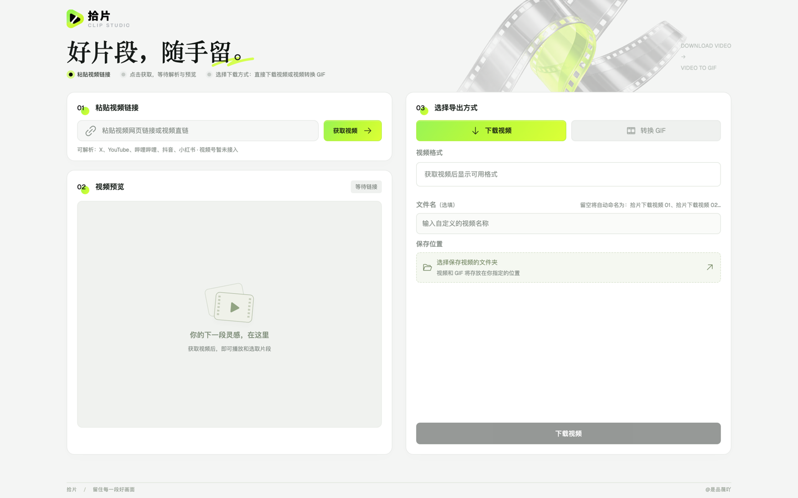

# 拾片 · 本地视频下载与 GIF 工作台

粘贴一条视频链接（或导入本地视频），在浏览器里预览，然后**下载原视频**，或**截取片段转成 GIF**——全部在你自己的电脑上完成。

**解决的问题**：想从网页视频里存一段素材、做一张表情包 GIF，往往要在「下载器 + 剪辑软件 + 转换网站」之间来回切换，在线转换站还要上传文件、限大小、加水印。拾片把这几步合在一个本地页面里：解析、预览、选片段、变速、控制 GIF 大小、保存到指定文件夹，一次搞定，视频不经过任何第三方服务器。



| 获取视频后：选择格式下载原视频 | 转换 GIF：变速、选片段、精度与大小 |
|---|---|
|  |  |

## 功能

- **链接解析**：由 [yt-dlp](https://github.com/yt-dlp/yt-dlp) 解析网页链接或视频直链，列出来源实际提供的格式、分辨率和文件大小。
- **导入本地文件**：点击选择或直接拖入 mp4 / mov / webm / mkv 等视频，跳过链接解析。
- **转 GIF**：5 / 10 / 15 秒预设或自定义选段；原速、1.5、2、3 倍四档变速；低 / 中 / 高三档精度；可填写大小上限（50 KB～100 MB），自动降低分辨率、帧率、调色板以满足上限。
- **保存**：选择一次保存文件夹后自动记住；留空文件名时自动编号，不覆盖已有文件。
- **安全**：服务只监听 `127.0.0.1`，接口带一次性令牌；不读取浏览器 cookies，不登录任何账号。

## 运行环境（必须）

拾片**不是纯静态网页**，需要在本机运行一个 Python 后端来调用 yt-dlp 和 FFmpeg：

| 依赖 | 用途 | 版本 |
|---|---|---|
| Python | 本地服务 `server.py` | 3.10+ |
| [yt-dlp](https://github.com/yt-dlp/yt-dlp) | 解析与下载视频 | 见 `requirements.txt` |
| [FFmpeg](https://ffmpeg.org/)（含 ffprobe） | 预览转码、截取、转 GIF | 4.x+ |
| Node.js | 仅修改前端或重新构建时需要 | 18+ |

macOS 安装 FFmpeg：

```bash
brew install ffmpeg
```

Windows / Linux 请从 [ffmpeg.org](https://ffmpeg.org/download.html) 安装，并确保 `ffmpeg`、`ffprobe` 在 PATH 中。

## 安装与运行

```bash
git clone https://github.com/xiaoniudaodao/clip-studio-local.git
cd clip-studio-local
```

```bash
python3 -m venv .venv
```

```bash
.venv/bin/pip install -r requirements.txt
```

```bash
npm ci && npm run build
```

```bash
.venv/bin/python3 server.py
```

然后用浏览器打开 <http://127.0.0.1:8766>。在链接框输入 `demo` 并点「获取视频」，可以用自带的测试片先试一遍。

macOS 也可以直接双击 `启动拾片.command` 启动（会优先使用项目内的 `.venv`）。按 `Ctrl+C` 或关闭终端窗口停止服务。

### 可选配置

需要改端口或指定 FFmpeg 路径时，复制示例配置后按需填写：

```bash
cp .env.example .env
```

| 变量 | 说明 | 默认 |
|---|---|---|
| `CLIP_PORT` | 服务端口 | `8766` |
| `CLIP_FFMPEG` / `CLIP_FFPROBE` | FFmpeg / FFprobe 可执行文件路径 | 依次查找 PATH、`/opt/homebrew/bin`、`/usr/local/bin` |
| `CLIP_PYTHON` | `启动拾片.command` 使用的 Python | 项目内 `.venv`，否则系统 `python3` |

### 开发

先启动 `server.py`，再另开一个终端运行 Vite 开发服务器（接口自动代理到本地服务）：

```bash
npm run dev
```

测试：

```bash
node --test tests/export-utils.test.js
```

```bash
.venv/bin/python3 -m unittest discover -s tests -v
```

## 技术栈

- 前端：React 19、Vite 6、Tailwind CSS 4、Phosphor Icons、Geist 字体
- 后端：Python 标准库 `http.server`（无 Web 框架）、yt-dlp、FFmpeg / FFprobe
- 系统窗口：macOS 用 `osascript` 弹出文件夹 / 文件选择；其他系统用 Python 自带的 tkinter

## 已知限制

- **必须本机运行后端**，不能部署成 GitHub Pages 这类静态网站；服务只监听 `127.0.0.1`，也不适合公开部署到服务器。
- B 站公开视频使用公开播放接口，显示来源实际返回的清晰度；未登录时可能仅提供低清，暂不支持多段视频流。
- 分享文字、Markdown 转义网址及相同网址重复粘贴会先清理；下载复用本次解析结果，预览遇到失效媒体流会尝试其他实际可用格式。
- 能否下载取决于 yt-dlp 对该平台的支持。需要登录、验证码、DRM、会员或私密的视频大多会失败；本工具不读取浏览器 cookies。仅支持单条、非直播视频；微信视频号暂不支持。
- 获取时会先下载完整视频用于预览，长视频准备时间较久，缓存放在项目 `.cache/` 下，目前没有自动清理，可手动删除。
- 没有后台任务取消；重启服务后旧任务失效，需要刷新页面重新获取。
- 主要在 macOS + Chrome / Edge 上测试，Windows / Linux 未完整验证。
- 音视频分离的来源合并后保存为 MKV。

## 使用须知

请只下载你有权保存的内容，并遵守视频来源平台的服务条款与当地版权法规。本项目仅提供本地工具，不提供、不托管任何视频内容。

## 协议

[MIT](LICENSE) © 2026 是品薇吖
